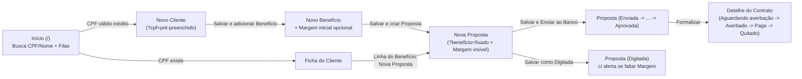

# Especificação de Fluxos Operacionais e Melhorias de UX

Documento consolidado a partir dos testes ponta a ponta na aplicação (`Banco -> Cliente -> Benefício -> Margem -> Proposta -> Contrato`) e das decisões alinhadas em conjunto (ver [ADR 0012](adr/0012-fluxos-operacionais-e-modalidades-na-interface.md)).

---

## 1. Diagnóstico do fluxo atual

Durante a execução real da aplicação em `localhost:8000`, foram mapeados os seguintes gargalos operacionais e defeitos de interface:

1. **Início sem função operacional (`/`):** exibe apenas uma saudação fixa, obrigando o Operador a abrir o menu lateral para buscar um Cliente ou encontrar pendências.
2. **Pingue-pongue no primeiro atendimento (`Cliente -> Benefício -> Margem -> Proposta`):**
   - Criar Benefício não permite informar a **Margem consignável** inicial (mesmo o Operador já tendo o valor em mãos ao consultar o benefício) e redireciona de volta para a ficha do Cliente.
   - A tabela de Benefícios em `clientes/templates/clientes/detalhe.html` não exibe a `Margem vigente` nem ação rápida de `Nova Proposta`.
   - O botão `Nova Proposta` na ficha do Cliente aparece mesmo quando o Cliente não possui nenhum Benefício ativo e aponta para `/propostas/nova/` sem pré-selecionar contexto.
   - A tela `beneficios/templates/beneficios/detalhe.html` (onde se registra a Margem) não possui botão `Nova Proposta`, embora `propostas.views.CriarView` já aceite `?beneficio=<pk>`.
3. **Criação de Proposta sem visibilidade da Margem e com `<select>` global:**
   - `/propostas/nova/` carrega todos os Benefícios de todos os Clientes em um único `<select>`.
   - Nem a criação nem a edição da Proposta exibem a `Margem vigente` do Benefício; uma parcela acima da Margem (ex.: `R$ 950,00` contra `R$ 850,00`) é salva sem alerta e só falha ao clicar depois em `Enviar ao Banco` (além de formatar decimais com ponto na mensagem de erro).
4. **Bugs e ruído visual em `Proposta` e passagem para `Contrato`:**
   - **Bug:** `propostas/templates/propostas/detalhe.html` verifica ``, mas `Proposta` não possui a property `encerrada`. Resultado: os formulários `Recusada pelo Banco` e `Desistência` continuam abertos inclusive em Propostas `Formalizada`, `Recusada` ou `Cancelada`.
   - `Recusada pelo Banco` aparece já no status `Digitada` (antes mesmo do envio ao Banco).
   - Ao clicar em `Formalizar`, o usuário permanece na Proposta e vê uma tabela completa de 10 colunas cujo único link para o Contrato criado é o algarismo do ID (`3`).
5. **Listagens, formatação e perfis (`Contratos`, `Modalidades`, `Supervisor`):**
   - `/contratos/` filtra por Cliente, mas não mostra a coluna **Cliente** na tabela.
   - Valores monetários saem sem separador de milhar (`R$ 25000,00`) e telefones sem máscara (`11988887777`).
   - **Modalidade** só é gerenciável no `/admin/`, quebrando a simetria com **Banco** (`/bancos/`).
   - **Permissão ausente:** o grupo `Supervisor` não recebeu `contratos.change_contrato`, ficando impedido de operar transições de Contratos.

---

## 2. Novo fluxo ponta a ponta

---

## 3. Especificação por frente

### Frente 1 — Central Operacional no `Início` (`/`)

- **Busca rápida de atendimento no topo (HTMX):**
  - Campo único de busca por CPF (com ou sem pontuação) ou nome do Cliente.
  - Resultados instantâneos abaixo do input com Nome, CPF mascarado, quantidade de Benefícios ativos e atalho direto para abrir a ficha do Cliente.
  - Se o termo digitado for um **CPF válido** sem cadastro correspondente, exibir estado vazio acionável: *"Nenhum Cliente encontrado para o CPF XXX.XXX.XXX-XX"* + botão **`Cadastrar Cliente com este CPF`** (`/clientes/novo/?cpf=...`).
- **Filas de trabalho abaixo da busca:**
  - **Propostas em andamento:** lista enxuta das Propostas não encerradas (`Digitada`, `Enviada ao Banco`, `Em análise`, `Aguardando saldo`, `Portabilidade autorizada`, `Aprovada`), destacando badges de ação imediata (`Digitada` e `Aprovada`).
    - Filtro rápido **`Minhas` | `Todas`**: padrão `Minhas` para Operador e `Todas` para quem pertence ao grupo `Supervisor`.
  - **Contratos pendentes:** Contratos em `Aguardando averbação` e `Averbado` (aguardando pagamento), com link direto para o Contrato e nome do Cliente.

### Frente 2 — Jornada encadeada `Cliente -> Benefício + Margem`

- **Novo Cliente (`/clientes/novo/`):**
  - Aceita `?cpf=` na query string para pré-preencher o campo CPF vindo da busca.
  - Rodapé do formulário com dois botões de submissão:
    - `Salvar` (comportamento atual: vai para `/clientes/<pk>/`);
    - **`Salvar e adicionar Benefício`** (redireciona direto para `/beneficios/cliente/<pk>/novo/`).
- **Novo Benefício com Margem inicial (`/beneficios/cliente/<cliente_pk>/novo/`):**
  - Além de `Número do Benefício` e `Espécie`, inclui seção/campos opcionais de **Margem consignável inicial**:
    - `Valor da Margem (R$)` (opcional);
    - `Data da consulta` (opcional, pré-preenchida com a data de hoje; exigida se o valor for informado).
  - Se o valor da Margem for preenchido, `services.criar_beneficio` (ou composição transacional no service) cria o `Benefício` e registra a `Margem` inicial na mesma transação (`@transaction.atomic`).
  - Rodapé com dois botões:
    - `Salvar` (volta para `/clientes/<cliente_pk>/`);
    - **`Salvar e criar Proposta`** (redireciona direto para `/propostas/nova/?beneficio=<beneficio_pk>`).
- **Ficha do Cliente (`/clientes/<pk>/`) e Detalhe do Benefício (`/beneficios/<pk>/`):**
  - Tabela de Benefícios do Cliente passa a exibir a coluna **`Margem vigente`** (valor formatado + data ou badge `"Sem margem"` / `"Vencida > 30d"`) e ação **`Nova Proposta`** (`/propostas/nova/?beneficio=<pk>`) por linha de Benefício ativo.
  - Se o Cliente tiver apenas 1 Benefício ativo, o botão `Nova Proposta` do cabeçalho da seção Propostas já aponta para `?beneficio=<unico_pk>`; se tiver vários, foca/abre seleção apenas entre os Benefícios daquele Cliente; se não tiver nenhum Benefício ativo, o botão `Nova Proposta` fica desabilitado/oculto com dica *"Cadastre um Benefício ativo para criar uma Proposta"*.
  - Tela `/beneficios/<pk>/` ganha botão **`Nova Proposta`** no cabeçalho (`/propostas/nova/?beneficio=<pk>`).

### Frente 3 — Criação e edição contextual de `Proposta`

- **Seleção de Benefício sem `<select>` global:**
  - **Com contexto (`?beneficio=<pk>` ou na edição):** exibe card fixo no topo com Cliente, Número/Espécie do Benefício e `Margem vigente` (com opção discreta `"Trocar Benefício"` se necessário).
  - **Sem contexto (`/propostas/nova/` via menu lateral):** exibe busca HTMX por CPF, nome do Cliente ou número do Benefício (listando apenas Benefícios ativos) que, ao selecionar um item, preenche o campo oculto `beneficio` e renderiza o card de contexto com a `Margem vigente`.
- **Atualização rápida de Margem sem sair da Proposta:**
  - Dentro do card de resumo do Benefício (no formulário da Proposta e na tela de detalhe da Proposta `Digitada`), exibir ação **`Atualizar/Registrar Margem`** (colapsável/modal via HTMX) que chama o registro de Margem e atualiza o resumo sem perder os valores digitados na Proposta.
- **Dupla submissão no formulário de Proposta:**
  - **`Salvar como Digitada`:** salva o rascunho em `Digitada` mesmo sem Margem ou com `Parcela > Margem`. Na tela de detalhe da Proposta `Digitada`, se houver impedimento para envio (`Sem Margem`, `Parcela > Margem` ou `Margem > 30 dias`), um alerta contextual já informa exatamente o que ajustar antes de enviar.
  - **`Salvar e Enviar ao Banco`:** executa `criar_proposta` (ou `editar_proposta`) + `enviar_proposta` em uma única transação atômica:
    - Se faltar Margem ou `Parcela > Margem`, nenhum registro órfão é gravado e o erro aparece direto no formulário (com valores formatados em pt-BR).
    - Se a `Margem` tiver mais de 30 dias, o formulário exibe a confirmação explícita (`Enviar mesmo assim com Margem de DD/MM/AAAA`) sem obrigar ida e volta.

### Frente 4 — Passagem `Proposta -> Contrato` e limpeza das telas de detalhe

- **Progressão de etapas:**
  - Mantida a ordem estrita etapa por etapa definida no ADR 0011 (`Digitada -> Enviada ao Banco -> Em análise -> [Aguardando saldo -> Portabilidade autorizada] -> Aprovada -> Formalizada`, e no Contrato `Aguardando averbação -> Averbado -> Pago -> Quitado`).
  - No Contrato `Averbado`, o campo `Data de pagamento` já vem pré-preenchido com `timezone.localdate()`.
- **Redirecionamento pós-formalização e card de Contrato:**
  - Ao clicar em `Formalizar`, `FormalizarView` redireciona diretamente para `contratos:detalhe` do Contrato recém-criado, com mensagem de sucesso *"Proposta #X formalizada. Este é o Contrato #Y gerado."*
  - Na tela da Proposta `Formalizada`, a tabela de 10 colunas é substituída por um **card compacto do Contrato** (Status do Contrato, Valor liberado, Parcela, Pago em e botão claro **`Abrir Contrato #Y`**).
- **Correção e recolhimento das ações de encerramento:**
  - Adicionar `@property def encerrada(self)` em `Proposta` (`self.status in FINAIS`), eliminando a exibição indevida em Propostas finalizadas.
  - Exibir apenas encerramentos válidos para o status atual:
    - Em `Digitada`: apenas **`Cancelar por desistência`** (não existe recusa bancária antes do envio ao Banco);
    - De `Enviada ao Banco` até `Aprovada`: **`Recusada pelo Banco`** e **`Cancelar por desistência`** (respeitando `propostas.cancelar_proposta_aprovada` quando `Aprovada`).
  - Tanto na Proposta quanto no Contrato (`Cancelar Contrato`), os formulários com campo `Motivo` deixam de ficar permanentemente abertos e passam a abrir sob demanda (botão `btn-outline-danger` -> collapse Bootstrap / modal; mantendo aberto automaticamente se houver erro de validação).

### Frente 5 — Cadastro de `Modalidades` na interface e permissões de `Supervisor`

- **Telas de `Modalidades` em `Cadastros`:**
  - Novas rotas (ex.: `/modalidades/` ou `/propostas/modalidades/`), listadas no grupo **Cadastros** da sidebar (`core/navegacao.py`) para quem tem `propostas.view_modalidade`.
  - Funcionalidades espelhando `bancos`: listar (nome, indicador `Envolve portabilidade`, situação `Ativo`/`Inativo`), criar, editar, inativar e reativar, passando por `services.py` e `selectors.py` com registro de `_history_user`.
- **Permissão do `Supervisor` em `Contratos`:**
  - Nova migration de dados em `contratos` adicionando `change_contrato` ao grupo `Supervisor`.

### Frente 6 — Polimento transversal (tabelas, formatação pt-BR e navegação contextual)

- **Tabelas e cliques:**
  - `/contratos/` passa a exibir a coluna **`Cliente`** (linkando para a ficha do Cliente).
  - Parciais de listagem embutidas na ficha do Cliente (`propostas/partials/_linhas.html` e `contratos/partials/_linhas.html`) ocultam a coluna redundante `Cliente`.
  - Identificadores clicáveis passam de `3` para `#3` (com área de clique adequada).
- **Formatação brasileira consistente:**
  - Filtro/template tag compartilhado em `core` para moeda (`R$ 25.000,00`), taxa (`1,66% a.m.` / até 4 casas sem zeros supérfluos ou formato padronizado) e telefone (`(11) 98888-7777` / `(11) 3333-4444`), inclusive nas mensagens de `ErroDeNegocio` (`ParcelaAcimaDaMargem`).
- **Breadcrumbs e botão `Cancelar` contextual:**
  - Componente enxuto `componentes/_breadcrumb.html` no topo das páginas de detalhe e formulário (ex.: `Clientes / Maria Silva / Novo Benefício`).
  - Formulários passam a aceitar retorno contextual (`url_cancelar` calculada pela origem/`?next=` seguro via `url_has_allowed_host_and_scheme`).

---

## 4. Fatiamento sugerido para implementação

Para manter PRs/entregas pequenas, testáveis (TDD) e independentes:

| Fatia | Escopo | Apps afetados |
| :--- | :--- | :--- |
| **1. Correções rápidas, formatação e encerramentos** | Property `Proposta.encerrada`, visibilidade correta e collapse de `Recusar`/`Cancelar`, migration `change_contrato` para `Supervisor`, formatação pt-BR (moeda/telefone), coluna `Cliente` em Contratos e `#ID` nas tabelas. | `core`, `propostas`, `contratos` |
| **2. Breadcrumbs, retorno contextual e `Proposta -> Contrato`** | Componente de breadcrumb, `url_cancelar` contextual nos formulários, redirecionamento direto ao Contrato pós-formalização, card de Contrato na Proposta e `Data de pagamento` padrão hoje. | `core`, `clientes`, `beneficios`, `propostas`, `contratos` |
| **3. Jornada encadeada `Cliente -> Benefício + Margem`** | `?cpf=` em Novo Cliente, botão `Salvar e adicionar Benefício`, campos opcionais de Margem inicial em Novo Benefício + `Salvar e criar Proposta`, coluna `Margem vigente` e botões `Nova Proposta` contextualizados no Cliente e no Benefício. | `core`, `clientes`, `beneficios` |
| **4. Formulário inteligente de `Proposta` (HTMX + envio atômico)** | Busca HTMX de Benefício quando sem `?beneficio=`, card de resumo da `Margem vigente`, atualização inline de Margem via HTMX e dupla ação (`Salvar como Digitada` vs `Salvar e Enviar ao Banco`). | `beneficios`, `propostas` |
| **5. Cadastro de `Modalidades` na interface** | `services.py`, `selectors.py`, `forms.py`, `views.py`, templates de Modalidade e item em `Cadastros` na sidebar. | `core`, `propostas` |
| **6. Central operacional no `Início` (`/`)** | Busca HTMX de CPF/nome com atalho de cadastro inédito + filas de Propostas (`Minhas`/`Todas`) e Contratos pendentes. | `inicio`, `clientes`, `propostas`, `contratos` |
